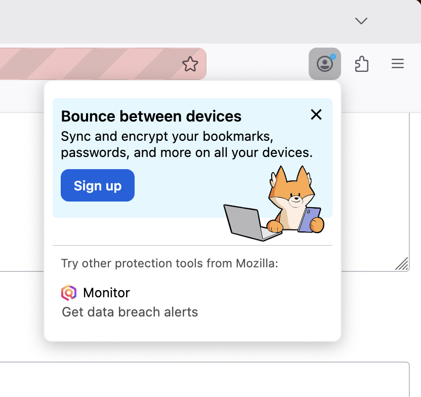
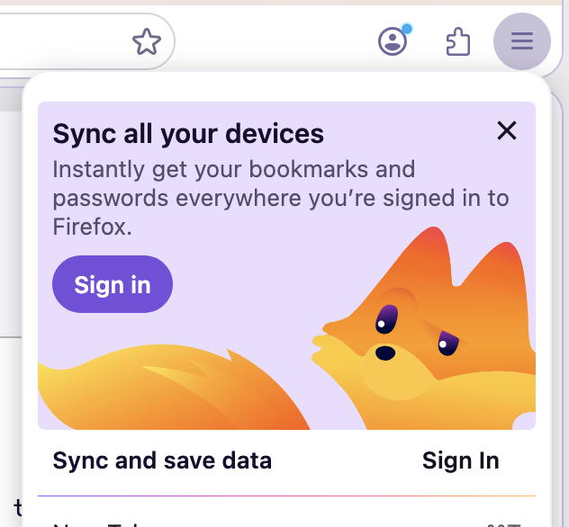
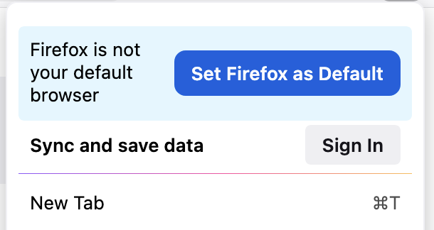
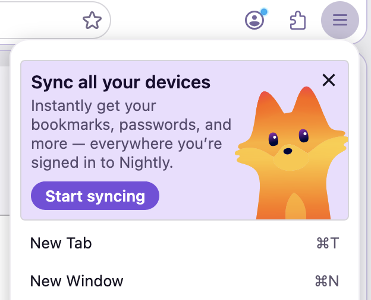

# MenuMessage

MenuMessage displays a contextual call-to-action card inside the App Menu (hamburger).



## Surfaces

| Surface | `testingTriggerContext` | Supported `messageType` |
|---------|------------------------|------------------------|
| App Menu | `app_menu` | `default_cta` |

## Message Types

- **`default_cta`**: General CTA. App Menu only.

## Layouts


- **`column`** (default): Illustration above text with a button stack below. Set `imagePosition: "bottom"` to render the illustration full-bleed at the bottom of the card instead.

- **`row`**: Text on the left, button and illustration on the right.

- **`simple`**: Single row with primary text and button only — no image, secondary text or close button.

- **`split`**: Two-column layout (illustration and copy). Use `imagePosition` `"start"` or `"end"` to swap which side the illustration sits on and `"bottom"` to have it aligned block-end. Default is `"end"`.

## Testing Menu Messages
Previewing the layout options and configurations can be done through `./mach storybook` or through `about:asrouter`, as seen below. See the [MenuMessage Schema](https://searchfox.org/mozilla-central/source/browser/components/asrouter/content-src/templates/OnboardingMessage/MenuMessage.schema.json) for the available configuration options.

### Using ASRouter devtools:
1. Set `browser.newtabpage.activity-stream.asrouter.devtoolsEnabled` to `true` in `about:config`
2. Go to `about:asrouter`
3. Select `panel` as the provider and find messages with `"template": "menu_message"`
4. Click **Show** — the `testingTriggerContext` field on the message determines which menu surface is simulated (`app_menu`).
5. Paste custom JSON in the text area and click **Modify** to preview changes

### Example JSON

```json
{
    "id": "EXAMPLE_APP_MENU_SPLIT_LAYOUT",
    "template": "menu_message",
    "content": {
        "layout": "split",
        "messageType": "default_cta",
        "primaryText": {
            "string_id": "example-menu-message-primary-text"
        },
        "secondaryText": {
            "string_id": "example-menu-message-secondary-text"
        },
        "primaryActionText": {
            "string_id": "example-menu-message-button"
        },
        "imageURL": "chrome://browser/content/asrouter/assets/kit-peek.svg",
        "imageVerticalBottomOffset": -8,
        "imagePosition": "bottom",
        "imageWidth": 95,
        "primaryAction": {
            "type": "OPEN_URL",
            "data": {
                "args": "https://example.com",
                "where": "tab"
            }
        },
        "closeAction": {
            "type": "BLOCK_MESSAGE",
            "data": {
                "id": "EXAMPLE_APP_MENU_SPLIT_LAYOUT"
            }
        }
    },
    "trigger": {
        "id": "menuOpened"
    },
    "testingTriggerContext": "app_menu",
    "groups": [],
}
```

## Schema

[MenuMessage.schema.json](https://searchfox.org/mozilla-central/source/browser/components/asrouter/content-src/templates/OnboardingMessage/MenuMessage.schema.json)

## Related Docs

- {doc}`Targeting attributes </browser/components/asrouter/docs/targeting-attributes>`
- {doc}`Triggers </toolkit/components/messaging-system/docs/TriggerActionSchemas/index>`
- {doc}`Special Message Actions </toolkit/components/messaging-system/docs/SpecialMessageActionSchemas/index>`
